# Studio Dany TV

A living pixel-art beach for a Samsung TV. A tiki bar in Playa del Carmen that follows the real
sun, the real weather and the Mexican calendar, with a lofi radio that changes with the time of day.
It runs as a signed Tizen web app on a stock 98" Samsung panel at a steady 60 fps, built and
deployed entirely from a Mac by an AI coding agent working through a phone camera pointed at the TV.

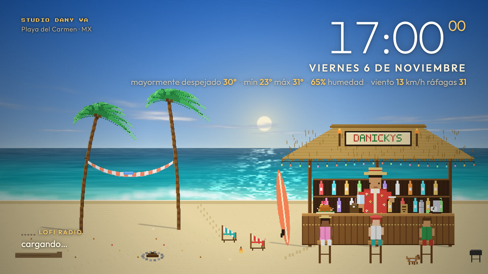

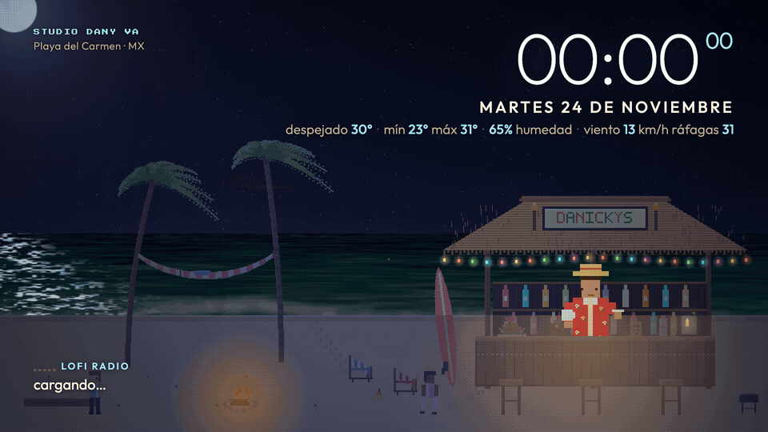

| 09:00, the coffee bar | 22:00, bulbs on | Golden hour at the counter | Rain |
|---|---|---|---|
| 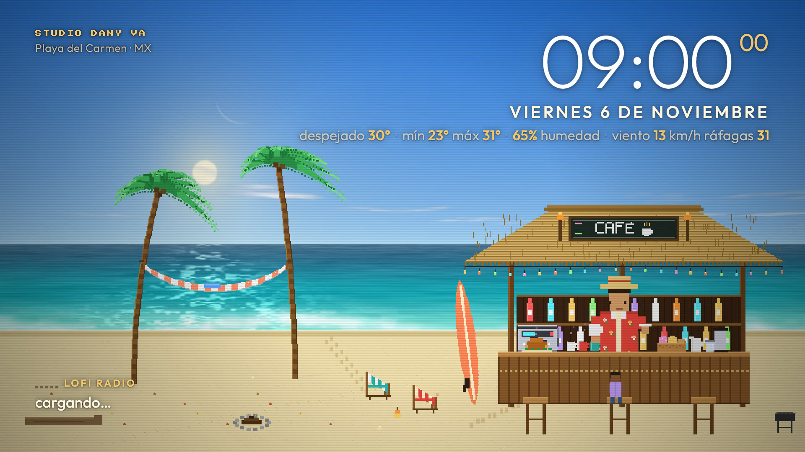 | 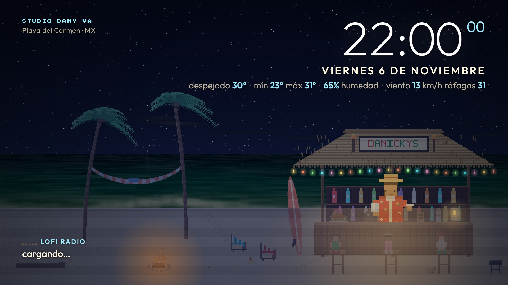 | 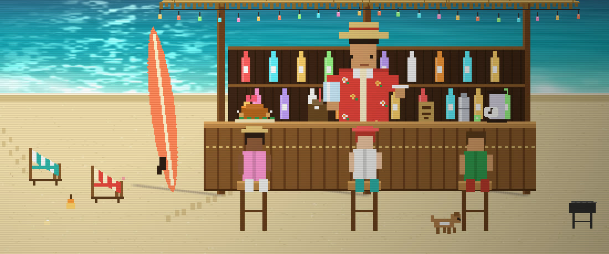 | 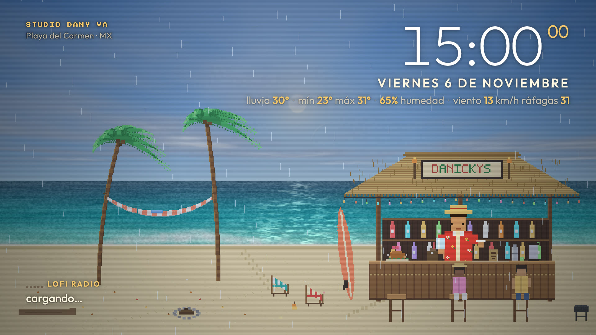 |

| Noon | Night | Día de Muertos | Summer |
|---|---|---|---|
| 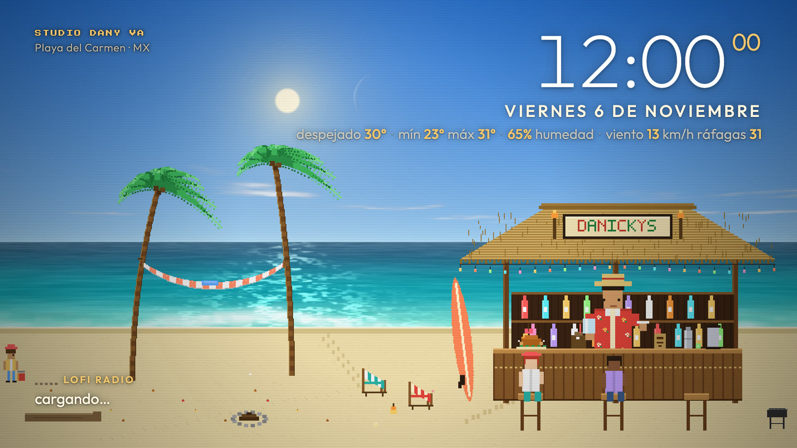 | 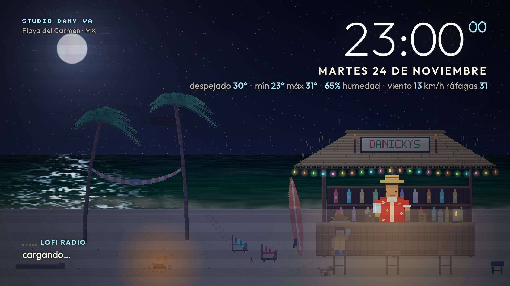 | 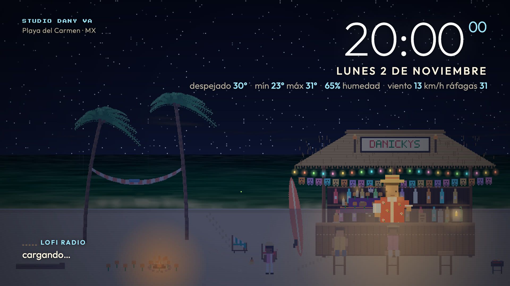 | 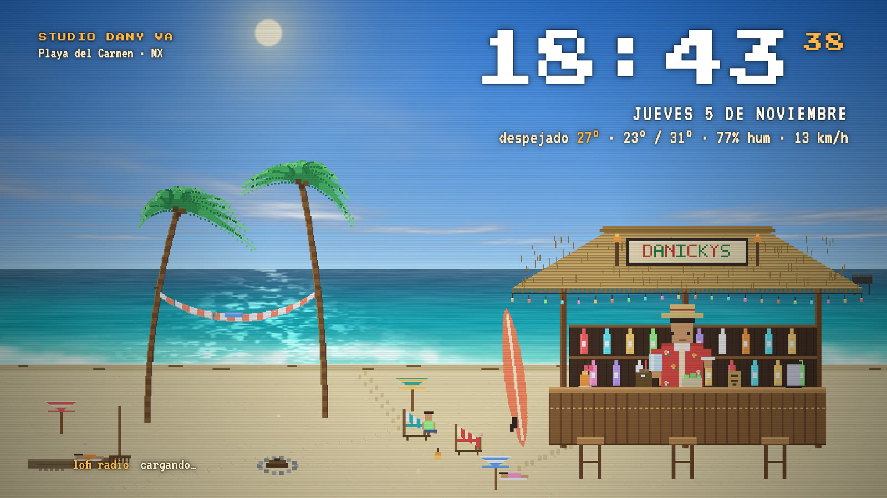 |

On the real panel, photographed through the watcher (the Mac's camera): the coffee bar at 09:00,
golden hour with three regulars and a dog, and 22:00 with the bulbs on, all at 60 fps.

| 09:00 | 17:00 | 22:00 |
|---|---|---|
| 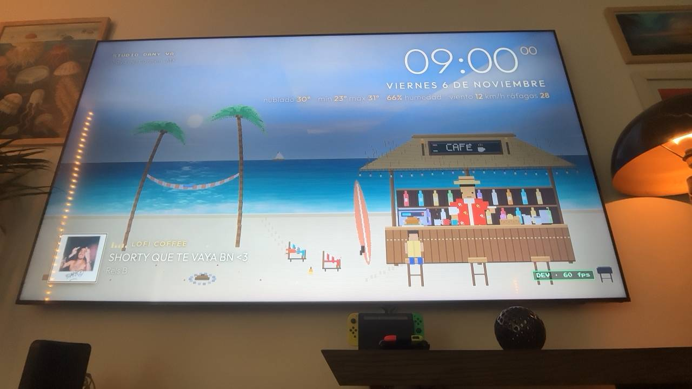 | 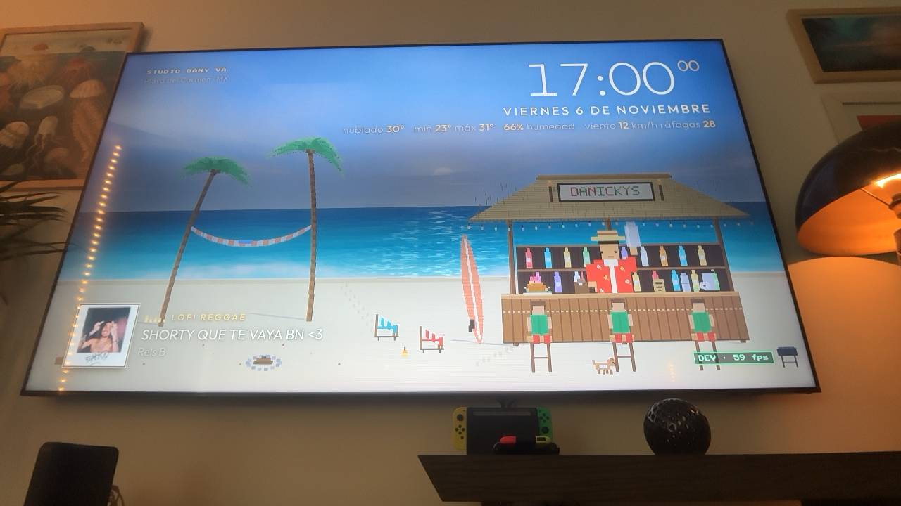 | 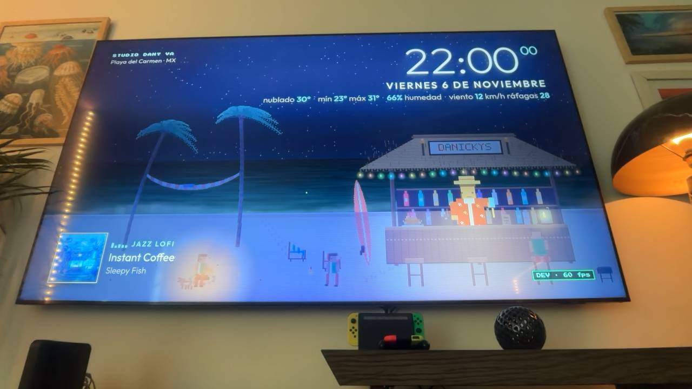 |

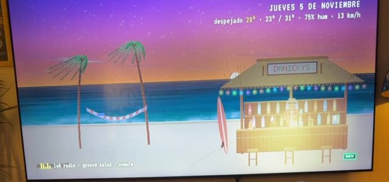

## What it does

- **Sky by real astronomy.** SunCalc gives the real sun and moon positions for the bar's
  coordinates; the sky interpolates pre-dawn, sunrise, day, golden hour, sunset, blue hour and
  night. The moon rises and sets at the real times with its real phase and orientation, stars
  twinkle and the Milky Way comes out on dark nights (a full moon washes them out).
- **Weather by Open-Meteo.** The WMO weather code and wind speed drive clouds, rain over the sea
  and drops on the palapa, puddles on the counter, fog, lightning storms, wave height and palm sway.
  Night and rain still look cozy under the string lights.
- **Mexican calendar decorations.** Rosca de Reyes in January, hearts in February, Semana Santa
  tourists, papel picado for Cinco de Mayo and the Grito, pumpkins for Halloween, an ofrenda with
  cempasúchil and candles for Día de Muertos, Christmas lights and a piñata in December, and a
  New Year's Eve countdown. All of it is data in `decorations.json`.
- **A bar with a schedule.** Dark and closed from 3 to 6:30 with one lamp on. From 6:30 it is a
  coffee bar: espresso machine, mugs with steam, a coffee bag, a basket of conchas and a
  chalkboard that says CAFÉ, and the bartender grinds and pours the kettle. Between 11:30 and
  12:00 the props swap one by one (cocktail first, the DANICKYS sign last) and it is the tiki bar
  again: cocktails, shaker, limes. The grill is lit at dinner, string lights from sunset.
- **Patrons.** Small characters walk in from the left along the sand, take a stool, chat with
  tiny icon bubbles, drink and leave: one or two at a time by day, three at golden hour and in
  the evening, none between 3 and 6. Now and then a dog comes with its owner, a kid digs with a
  bucket near the shore, or someone takes a selfie (with the flash). Every pose is a cached frame.
- **Wind you can see.** Open-Meteo's wind speed and gusts drive the palms (calm below 8 km/h,
  gentle to 20, strong to 35, storm above), the wave height, the hammock, the string lights
  swinging, and above ~20 km/h leaves torn from the crowns and sand streaking along the ground.
- **Living scene.** A pelican flies by, a crab walks its path, the Cozumel ferry and a sailboat
  cross the horizon, smoke rises from the fire pit, fireflies at night, and the bartender wipes
  glasses, shakes cocktails and pours.
- **HUD.** A big, smooth clock in Outfit (light weight, seconds smaller in the accent colour),
  the Spanish date, and a weather line with hierarchy: values in the accent, labels softer. The
  accent follows the day: sand-gold in daylight, coral around sunrise and sunset, pale cyan at
  night. Bottom-left, the Spotify cover at 160 px (nearest-neighbour, so it reads as pixel art)
  next to the slot, equalizer, track and artist.
- **Spotify Connect by time of day.** Lofi Coffee in the morning, Lofi Reggae in the afternoon,
  Jazz Lofi at night: at each boundary (06/12/19) the slot's playlist starts on the chosen Connect
  speaker with shuffle on and repeat off. The HUD shows track, artist, slot and a pixelated album
  cover. OK toggles play/pause, left/right skips tracks. Playlists live in `playlists.json`. If
  Spotify is unreachable the app falls back to internet lofi streams (`radio.json`) and returns to
  Spotify when it is back.
- **Dev overlay** on the `0` key to force any hour, weather code, month, day or wind, switch
  render quality, and run the benchmark or the radio test. Keys `1-4` jump to review hours,
  `6-9` to Día de Muertos, Christmas, rain and storm.

## Architecture

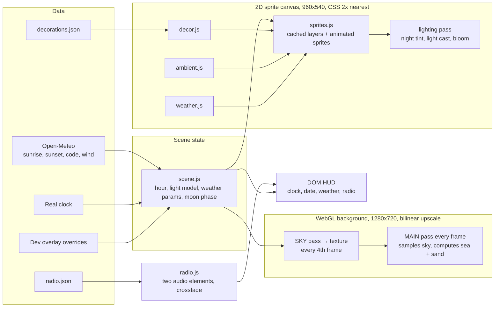

Three layers are composited by the TV's browser: the WebGL canvas (sky, sea, sand base), the 2D
sprite canvas on top (transparent above the shore line), and the DOM HUD.

### Real astronomy (`js/astro.js` on [SunCalc](https://github.com/mourner/suncalc), vendored, MIT)

Nothing in the sky is decorative. For the bar's coordinates and the scene's Date (real, or
forced through the dev overlay), `astro.js` computes the sun's altitude and azimuth, the day's
times (dawn, sunrise, golden hour, sunset, dusk, night), the moon's altitude and azimuth, its
illuminated fraction and phase, the orientation of its bright limb as seen from the beach
(bright-limb angle minus parallactic angle), and moonrise/moonset. The painting faces south:
east is on the left, west on the right. Azimuth is compressed horizontally (a 270° window fits
the frame) and altitude is linear in degrees; timing, altitude, phase and orientation are real.
So the moon rises, crosses and sets at the real times and is simply absent when below the
horizon, the crescent's horns point the right way, and the moon path on the water is as bright as
the illuminated fraction. Stars and the Milky Way fade with twilight and with moonlight.

Verified against the US Naval Observatory (rise/set, illumination) and NASA's Dial-a-Moon
(age, illumination at 23:00) for Playa del Carmen, 2026:

| Date | Reference | SunCalc in the app |
|---|---|---|
| Nov 5 | waning crescent 13% (NASA 23:00: 11.3%, age 26.3 d); moonrise 03:36, moonset 15:49; sunrise 06:53, sunset 18:11 | 12.4%, age 26.2 d; moonrise 03:38, moonset 15:55; sunrise 06:53, sunset 18:12. At 18:17 the moon is 32° below the horizon: not drawn |
| Nov 24 | full moon 100% (09:53); moonset 07:03, moonrise 18:10; sunrise 07:04, sunset 18:06 | 99.8%, age 14.3 d; moonset 07:03, moonrise 18:04; sunrise 07:05, sunset 18:07. At 23:00 the moon stands 61.7° high in the ENE |
| Dec 9 | waxing crescent 1% (new moon Dec 8 19:52); moonrise 07:49, moonset 18:40; sunrise 07:13, sunset 18:08 | 0.7%, age 0.8 d; moonrise 07:51, moonset 18:45; sunrise 07:14, sunset 18:09 |

Largest differences: 6 minutes on a moonset, about 1% in illumination, which is the precision
SunCalc advertises. Open-Meteo's sunrise/sunset are kept only as a cross-check in the dev overlay,
which also shows the phase name in Spanish, illumination, age, altitude/azimuth and rise/set times
for any forced date (year, month, day and hour are all forceable).

### The sky and sea shaders (`js/shaders.js`)

The light model is shared by both passes and by the sprite layer. From the real sun altitude
`a`, the elevation is `sin(a)` (so `-0.10` is civil dusk, 6° below the horizon). Two scalars come
out of it: `d`, the daylight amount (a smoothstep of the elevation), and `tw`, a twilight bump
that peaks when the sun is on the horizon. Every colour in the sky is a blend of three palettes
(night, twilight, day) weighted by `d` and `tw`, so dawn and dusk get their pink and orange
horizon for free.

The sky pass draws the gradient, the sun (glow mixed in rather than added, so it never
saturates to a blob), stars from a per-cell hash with a time-based twinkle, a Milky Way band of
fbm noise, the moon at its real position with the terminator drawn as the ellipse
`u = -k·sqrt(1 - v²)` in disc coordinates oriented along the bright limb (`k = 2·fraction - 1`,
plus faint earthshine on the dark side), and clouds as fbm noise sampled in perspective (divided
by height above the horizon) so they flatten toward the horizon and drift with the wind. Because
the sky changes slowly, this pass renders to a texture only every 4th frame, which is what makes
the 5-octave quality tier affordable.

The main pass runs every frame. Above the horizon it just samples the sky texture. The sea gets
a deep-to-shallow Caribbean palette by distance to the shore, a reflection of the real sky sampled
just above the horizon (desaturated, so twilight doesn't turn the water pink), wave shading from
fbm in mild perspective, a vertical light path under the sun or moon filled with horizontal
shimmer streaks, a wavy foam line at the shore, and weather: rain speckle, overcast gloom, fog,
lightning flash. Wind and rain raise the waves.

### The sprite layer (`js/sprites.js`)

Everything is drawn in 960x540 logical pixels, and CSS scales the canvas 2x with
`image-rendering: pixelated`, so every pixel is the same size and no 1080p 2D work happens at all.
Static art (sand, bar back, bar front, light cast, bulb halos, post effects) is painted once into
offscreen canvases; the counter props and the ridge sign are one more cached layer, repainted
only when the bar schedule flips a prop (coffee set in the morning, tiki set from noon); palms and
the hammock are cached as 16 and 12 quantized sway frames, with amplitude and speed from the
effective wind (speed swelling toward the gusts on a slow envelope); patrons, the dog, the kid and
the selfie taker are cached pose frames at 1.5x; only the bartender, string lights, critters,
particles and weather are drawn fresh each frame. A lighting pass at the end applies the night
tint (`source-atop`, so the sea behind stays untouched) and twilight warmth; the bar gets a
slightly lighter version of the tint so roof, posts, bottles and sign keep a desaturated, bluish
night palette, while the warm cast from the string lights is clipped to the sand around the bar
and the counter top only. The bartender is drawn after that pass with his own palette, warmed by
the bulbs instead of stained by the cast, and the bulbs and their bloom stay bright.

### The month engine (`js/decor.js` + `decorations.json`)

A rule is `{from: "MM-DD", to: "MM-DD", layers: [...]}`. Every matching rule's layers are painted
into three cached canvases by depth (`sand`, `back`, `front`) and repainted only when the day
changes. Layers name a primitive (`papel`, `sign`, `ofrenda`, `xmaslights`, `umbrella`,
`tourist`, `pumpkin`, ...) plus parameters. Candles and Christmas lights register glow sources
that are drawn after the night tint so they stay bright. The New Year's Eve `countdown` is the
only per-frame layer.

### The weather engine (`js/weather.js`)

Maps the WMO code to `{cloud, rain, fog, storm}`. Rain is a deterministic field of streaks
scrolling down and sheared by the wind, plus small drops bouncing off the palapa eave and the
sand and a shimmer on the counter's puddles. Storms schedule a lightning bolt every 6 to 18 s:
a jagged polyline in the sky, a white flash on the sprites and a `u_flash` boost in both shaders
(the sky texture is refreshed on that frame).

## Performance notes (what the TV taught us)

The 2024 DU9000 has a Mali-G51 behind WebGL2. Measured on the panel:

| Background | fps |
|---|---|
| Full-screen procedural shader at 1920x1080 | 27-33 |
| Same at 3840x2160 | 5-10 |
| 1280x720, sky every frame, 5 octaves | 46 |
| 1280x720, sky to texture every 4th frame, 5 octaves | **60** |

And on the 2D side, every operation costs per pixel touched: a single full-screen 1080p canvas
fill or blit costs several milliseconds, so the sprite canvas is 960x540, every cached layer is
drawn cropped to its bounding box, and sway animations are cached frames. With all of that, the
complete scene (background, sprites, HUD, radio) holds 60 fps; the storm, the heaviest state,
reads 57.

## Install on any Samsung Tizen TV

Tested on a UN98DU9000 (Tizen 8/9). Any 2017+ Samsung TV with Developer Mode should work.

1. **TV**: Home → Apps, type `1 2 3 4 5` on the remote, set Developer Mode **On** and the Host
   PC IP to your computer's LAN IP, then power the TV fully off and on.
2. **Computer**: clone this repo and Samsung's agent skills, which install the Tizen SDK for you:
   ```bash
   git clone https://github.com/dany-ia/studio-dany-tv.git && cd studio-dany-tv
   git clone https://github.com/Samsung/tizen-agent-skills.git .skills-src
   bash .skills-src/tizen-sdk-skills/claude/setup/setup.sh      # Claude Code; see their README for other hosts
   ```
   Then, in your agent (or with the runners under `~/.claude/plugins/cache/tizen-platform/.../lib/cli/`):
   install the Tizen SDK, install the TV SDK extension, `remote-device connect <tv-ip>`.
3. **Certificate**: a Samsung online-CA author certificate plus a distributor certificate that
   lists your TV's DUID (`cert-manager acquire-duid`), combined into a signing profile. The
   runners handle the Samsung Account login in your browser. Keep the password file private.
4. **Build and run**:
   ```bash
   node <runners>/project-manager-cli.js build --project "$PWD/app/StudioDanyTV" --build-type Debug --sign-profile <profile>
   node <runners>/project-manager-cli.js install --package "$PWD/app/StudioDanyTV/Debug/StudioDanyTV.wgt" --run
   ```
5. **Autorun on power-on**: Settings → Advanced Features → Start Screen Options →
   **Autorun Last App** on (on 2024 Tizen 8 sets it lives under *Advanced Features*, not
   *General & Privacy*; Autorun Smart Hub Home can stay on). Leave the app in the foreground when
   you turn the TV off. Verified on the 98" DU9000: standby → wake brings the beach back with the
   music still playing. Home and Smart Hub keep working; Back exits the app.
6. **Location**: change `lat`, `lon`, `tz` in `js/app.js` and the place name in `index.html`.

Step-by-step details, rollback and the 5-minute redeploy after a firmware update are in
[REINSTALL.md](REINSTALL.md). The phone-camera watcher used to see the TV from the agent is
documented in [docs/WATCHER.md](docs/WATCHER.md).

## Spotify setup

The TV cannot do OAuth comfortably, so a tiny token broker (`tools/spotify-broker.js`, Node, no
dependencies) runs on a computer on the same LAN. It does the Authorization Code + PKCE login once,
keeps the refresh token in an untracked file, and hands short-lived access tokens to the TV app.
The TV then talks to the Spotify Web API directly (Premium account required for playback control).

1. Create an app at https://developer.spotify.com/dashboard with redirect URI
   `http://127.0.0.1:8888/callback` and copy its Client ID (no secret is needed).
2. `.local/spotify/config.json`: `{ "client_id": "..." }`. The broker adds a random `app_key` on
   first run; that key is the TV's credential (no IP allow-list, the TV's address may change).
3. `node tools/spotify-broker.js --login` opens the Spotify login in your browser; the refresh token
   lands in `.local/spotify/tokens.json` (mode 600). Keep the broker running: on the machine that
   stays on (a Mac Studio in the closet), `tools/broker-install.sh user@that-mac.local` copies the
   script and `.local/spotify/` over ssh and installs it as a LaunchAgent
   (`com.studiodany.spotify-broker`, RunAtLoad + KeepAlive, log in `~/Library/Logs`). Run only one
   broker at a time: the PKCE refresh token rotates, two brokers invalidate each other.
4. Pick the Connect device: `curl -H "X-App-Key: <app_key>" http://127.0.0.1:8899/devices`. A device
   only appears after it has been used from the Spotify app at least once.
5. Copy `app/StudioDanyTV/config.local.example.json` to `config.local.json` with the broker URL,
   the LAN prefix to scan, the app key and the device id. It is git-ignored and packaged into the
   `.wgt`. The broker's IP may change (ISP modems rarely offer DHCP reservations), so the app finds
   it at startup: it tries `brokerUrl` as written, then the last URL that worked (cached in
   localStorage), then a one-off scan of `brokerScan` hosts 2-254 on port 8899, 24 probes at a time,
   each candidate verified by `GET /status` answering `{"broker":"studiodany"}`. On this Tizen 8 TV
   the web engine does **not** resolve mDNS names (`*.local`), so in practice the scan finds the
   broker (about 2 s for a low address) and the cache makes the next boots instant. The dev overlay
   shows which path was used, e.g. `audio spotify @ 192.168.0.23 (scan)`.
6. `app/StudioDanyTV/playlists.json` holds the three playlist URIs (`coffee`, `reggae`, `jazz`).
   Swap them for your own.

Security: the broker binds the OAuth dance to loopback only, and the LAN token endpoint answers
only private (RFC 1918) source addresses presenting the app key; `/status` is public on the LAN but
carries nothing beyond the broker's name and whether it is logged in. Nothing is exposed to the
internet. Tokens are never committed (`.local/` and `config.local.json` are ignored).

## Repository layout

```
app/StudioDanyTV/      the Tizen web app (index.html, js/, css/, fonts/, radio.json, decorations.json)
app/StudioDanyHello/   the phase-1 hello app used to prove the toolchain
watcher/               private phone-camera watcher (HTTPS, single-use pairing) + agent helper
tools/                 tvremote.py (Samsung WebSocket remote), validate.sh
docs/                  watcher guide, images
reference/             the original ambient mockup this started from
```

## Credits

- Methodology: [Samraaj's TV makeover prompt](https://gist.github.com/Samraaj/9c3d02af9a4d8573c38fc8ba2db0bf66)
  (camera watcher, no root, stock Home recoverable) and
  [victaphu/glass-home-samsung-tv](https://github.com/victaphu/glass-home-samsung-tv) for the
  original workflow.
- Toolchain: [Samsung/tizen-agent-skills](https://github.com/Samsung/tizen-agent-skills) (SDK
  install, certificates, build, deploy, all driven by the agent).
- Weather: [Open-Meteo](https://open-meteo.com/) (free, no key). Astronomy:
  [SunCalc](https://github.com/mourner/suncalc) by Volodymyr Agafonkin (MIT, vendored), verified
  against the [USNO](https://aa.usno.navy.mil/) and [NASA Dial-a-Moon](https://svs.gsfc.nasa.gov/).
- Radio: [SomaFM](https://somafm.com/), [laut.fm](https://laut.fm/), [FluxFM](https://www.fluxfm.de/),
  [I Love Radio](https://www.ilovemusic.de/), [Zeno.FM](https://zeno.fm/). Thank them, support them.
- Remote control: [samsungtvws](https://github.com/xchwarze/samsung-tv-ws-api).
- Fonts: Outfit (HUD), Press Start 2P and VT323 (all SIL OFL 1.1, vendored in `fonts/`).
- Built with Claude Code.

## En español

Una playa pixel-art viva para una Samsung de 98 pulgadas: el bar de la palapa en Playa del
Carmen sigue el sol real (amanecer y atardecer de Open-Meteo), el clima real (lluvia, tormenta
con relámpagos, niebla, viento) y el calendario mexicano (Reyes, 14 de febrero, Semana Santa,
10 de mayo, Grito, Halloween, Día de Muertos con su ofrenda, Navidad y la cuenta regresiva de
Año Nuevo, todo editable en `decorations.json`). Reloj pixel con segundos, fecha en español,
clima y una radio lofi que cambia según la hora (café por la mañana, reggae por la tarde, jazz
de noche; estaciones en `radio.json`). Corre a 60 fps como app Tizen firmada, sin root ni
cambios al sistema: el Home y Smart Hub siguen funcionando. La guía de instalación para cualquier
Samsung Tizen está arriba y en `REINSTALL.md`.
